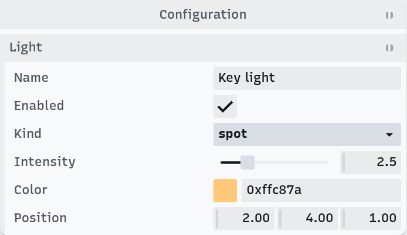
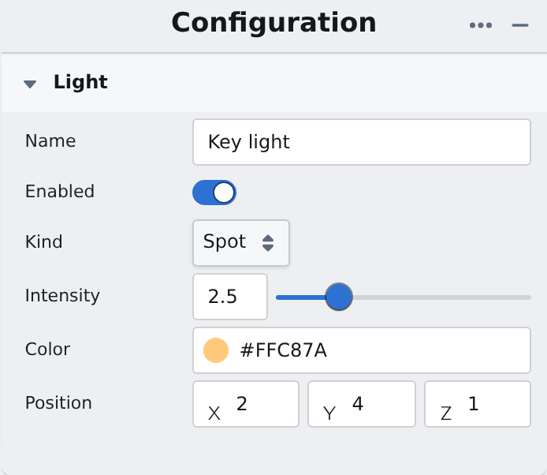

# uiconfig.js

[](https://www.npmjs.com/package/uiconfig.js)
[](./LICENSE)

Describe a UI as plain objects bound to your data, and render it as a live panel with Tweakpane, Blueprint or your own components.

**[Website](https://repalash.com/uiconfig.js/)** · **[Demos](https://repalash.com/uiconfig.js/examples/index.html)** · **[API docs](https://repalash.com/uiconfig.js/docs/)** · **[Guide](packages/uiconfig.js/README.md)**

<p>


</p>

```js
const settings = {exposure: 1, tonemap: 'ACES', grid: true}

const config = {
    type: 'folder',
    label: 'Render',
    expanded: true,
    children: [
        {type: 'slider', label: 'Exposure', bounds: [0, 4], stepSize: 0.1, property: [settings, 'exposure']},
        {type: 'dropdown', label: 'Tone map', property: [settings, 'tonemap'], children: ['Linear', 'ACES', 'AgX'].map(label => ({label}))},
        {type: 'checkbox', label: 'Grid', property: [settings, 'grid']},
        {type: 'button', label: 'Reset', onClick: () => { settings.exposure = 1; config.uiRefresh?.(true) }},
    ],
}

import {UI} from 'uiconfig-tweakpane' // or 'uiconfig-blueprint'
new UI().appendChild(config)
```

Moving the slider writes `settings.exposure`. Changing `settings` in code and calling `config.uiRefresh()` updates the panel.

## Why uiconfig

- **The UI lives next to the data.** A config is a plain object, so a library or a game object can describe its own controls without depending on any UI package. Only the app that shows the panel imports a renderer, and a debug panel can stay optional.
- **One config, any renderer.** The same config renders with Tweakpane for a compact tool panel, or with Blueprint for a full editor. Switching is a one-line import change.
- **Two-way binding.** `property: [object, 'key']` binds a control to a property; `value`, or `getValue`/`setValue`, work when there is no object. Labels, bounds, `hidden` and `disabled` can be functions, evaluated on each refresh.
- **Built for editors.** Folders, panels, sliders, dropdowns, colors and vectors, undo, three.js `Color` and `Vector` types, and custom components per renderer. [threepipe](https://threepipe.org) builds its editor UI with it.

## TypeScript decorators

In a class, decorators generate the config:

```ts
import {uiContainer, uiSlider, uiDropdown, uiToggle, uiButton, IUiConfigContainer, UiObjectConfig} from 'uiconfig.js'

@uiContainer('Render')
class RenderSettings implements IUiConfigContainer {
    uiConfig: UiObjectConfig

    @uiSlider('Exposure', [0, 4], 0.1)
    exposure = 1

    @uiDropdown('Tone map', ['Linear', 'ACES', 'AgX'])
    tonemap = 'ACES'

    @uiToggle('Grid')
    grid = true

    @uiButton('Reset')
    reset = () => {
        this.exposure = 1
        this.uiConfig.uiRefresh?.(true)
    }
}

new UI().appendChild(new RenderSettings().uiConfig)
```

Decorators need `"experimentalDecorators": true` in `tsconfig.json`.

## Install

```bash
npm install uiconfig.js uiconfig-tweakpane   # or uiconfig-blueprint
```

`uiconfig.js` holds the types and decorators. Plain JavaScript configs do not need it at all. Each renderer is a separate package:

| Package | What it is | |
|---|---|---|
| [uiconfig.js](packages/uiconfig.js) | Config types, decorators, renderer base classes | [](https://www.npmjs.com/package/uiconfig.js) |
| [uiconfig-tweakpane](packages/uiconfig-tweakpane) | Renderer on [Tweakpane](https://tweakpane.github.io/docs/) 3: a compact floating panel | [](https://www.npmjs.com/package/uiconfig-tweakpane) |
| [uiconfig-blueprint](packages/uiconfig-blueprint) | Renderer on [Blueprint](https://blueprintjs.com/) 5 (React): panels and editor layouts | [](https://www.npmjs.com/package/uiconfig-blueprint) |
| [uiconfig-react](packages/uiconfig-react) | React base classes and un-styled components | in development |
| [uiconfig-shadcn](packages/uiconfig-shadcn) | Components on [shadcn/ui](https://ui.shadcn.com/) for uiconfig-react | in development |

The renderer READMEs list their components and options.

## Learn more

- [Guide](packages/uiconfig.js/README.md): defining configs, the full config reference, binding, three.js.
- [Demos](https://repalash.com/uiconfig.js/examples/index.html): objects, classes, decorators, paths, threepipe.
- [API docs](https://repalash.com/uiconfig.js/docs/).

## Contributing

Issues and pull requests are welcome. [CONTRIBUTING.md](CONTRIBUTING.md) explains the setup, the builds and the release flow.

## License

[MIT](LICENSE)
